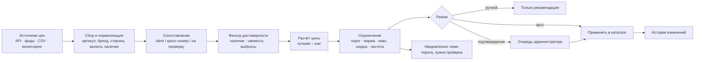

# 03. Конкурентное ценообразование — техническое задание

Статус: **ядро расчёта и концепт панели реализованы** (`src/pricing/engine.ts`, тесты `npm run test:pricing`, панель `/admin/pricing` на демо-данных). Реальные цены магазина не меняются: нет подключённых источников цен конкурентов и серверной части. Запуск — только после подключения данных, проверки формул на истории и подтверждения администратора.

## 1. Цель

Держать цену Asia Motor чуть ниже лучшей **подтверждённой** цены конкурента на **тот же** товар, не опускаясь ниже допустимого порога, и фиксировать каждое изменение.

Пример: наше крыло Haval H6 — 6000 грн, у конкурента идентичное — 5995 грн, шаг 1 грн → рекомендуем 5994 грн. Если минимальная цена 5800 грн, а конкурент ставит 5700 — не опускаемся ниже 5800 и уведомляем администратора.

## 2. Поток данных



## 3. Сопоставление товаров (самое важное)

Цену двигают **только** два вида совпадений:

| Тип | Условие | Используется автоматически |
|---|---|---|
| Идентичный | тот же артикул (нормализованный: без пробелов, дефисов, регистра) **и** тот же производитель | да |
| Подтверждённый аналог | артикул конкурента есть в нашей таблице кросс-номеров, которую ведёт менеджер | да |
| На проверку | тот же артикул, но другой бренд; или похожее название без совпадения артикула | нет — очередь ручной проверки |
| Не совпадает | другая сторона установки (левое/правое), разные модели, нет общих признаков | нет |

Дополнительно проверяются сторона установки, модель и годы (если есть в данных конкурента), оригинал/аналог. Если уверенность недостаточна, товар уходит на ручную проверку. Подтверждённые вручную пары сохраняются в таблицу соответствий и дальше используются автоматически.

## 4. Достоверность цены конкурента

Не учитываются:
- предложения «нет в наличии» / «под заказ» (настраивается);
- цены старше `staleHours` (по умолчанию 48 ч);
- другая валюта без пересчёта;
- выбросы: цена ниже `outlierPct` % от медианы остальных предложений (по умолчанию 60 %) — вероятная ошибка;
- пропавшие предложения: если конкурент убрал товар, его последняя цена «стареет» и перестаёт влиять.

## 5. Правила расчёта

```
порог   = max( минимальная цена товара,
               закупка × (1 + мин. маржа),
               базовая цена × (1 − макс. скидка) )
цель    = лучшая достоверная цена − шаг          (шаг по умолчанию 1 грн)
цель    = min(цель, базовая цена)                (если включено «не выше базовой»)

если цель < порог      → рекомендуем порог (не ниже), статус «ниже порога», уведомление
если цель < текущая    → «снизить» до цели
если цель > текущая    → «поднять» до цели (возвращаем маржу, когда мы и так дешевле)
если нет достоверных   → оставить или вернуть к базовой цене
```

Параметры (глобально и для каждого товара): режим, шаг, минимальная цена, минимальная маржа, максимальная скидка от базовой, наценка/базовая цена, «не выше базовой», свежесть данных, порог выброса, минимальный интервал между изменениями (`cooldownHours`), максимальное изменение за раз в авторежиме (`autoMaxStepPct`), исключение товара, ручная фиксация цены.

## 6. Режимы

1. **Ручной** — только рекомендации.
2. **Подтверждение** (по умолчанию) — рекомендации попадают в очередь; администратор подтверждает или отклоняет.
3. **Автоматический** — применяются изменения в пределах ограничений и `autoMaxStepPct`; «ниже порога», «на проверку» и крупные изменения всё равно идут на подтверждение.

## 7. История

Каждое изменение: время, товар, было → стало, кто (авто/администратор), причина (текст расчёта), конкурент и его цена, ссылка на исходные данные (снимок предложения). Хранится бессрочно, позволяет откатить цену.

## 8. Источники цен — законно и надёжно

| Способ | Когда | Примечание |
|---|---|---|
| Официальный API конкурента / маркетплейса | если есть публичный или партнёрский доступ | предпочтительно; соблюдать лимиты и условия |
| Партнёрские товарные фиды (YML/XML, CSV) | договорённость с поставщиком/партнёром | многие поставщики отдают прайсы |
| Агрегаторы и маркетплейсы с API (например, площадки запчастей) | если условия разрешают использование цен | проверить пользовательское соглашение |
| Мониторинг публичных страниц | только если это разрешено условиями и `robots.txt` сайта | низкая частота, идентифицируемый User-Agent, без обхода защиты |
| Ручной импорт прайса (CSV/Excel) | всегда доступно | реализовано в панели: `competitor;article;brand;title;price;in_stock;side` |

Запрещено: обход CAPTCHA, авторизации, ограничений частоты, блокировок, использование чужих учётных данных. Если источник не разрешает автоматический сбор — только ручной импорт.

## 9. Компоненты для запуска

| Компонент | Назначение | Где |
|---|---|---|
| Коннекторы источников | загрузка API/фидов/CSV по расписанию | сервер, очередь задач |
| Нормализатор | артикул, бренд, сторона, валюта, наличие | сервер |
| Таблица соответствий | подтверждённые пары «наш товар ↔ товар конкурента», кросс-номера | БД |
| Движок расчёта | `src/pricing/engine.ts` (переносится на сервер без изменений) | сервер |
| Планировщик | запуск 1–4 раза в сутки, с учётом `cooldownHours` | cron / очередь |
| Панель администратора | рекомендации, очередь проверки, правила, история | админка (`/admin/pricing` — концепт) |
| Уведомления | «ниже порога», «нужна проверка», ошибки источников | Telegram / e-mail |
| Журнал | история цен и снимки исходных данных | БД |

## 10. Критерии приёмки перед включением авторежима

- 2–4 недели в режиме подтверждения; доля ошибочных сопоставлений < 1 %.
- Сверка формул на исторических данных; ни одной цены ниже порога.
- Закупочные цены и минимальные пороги заполнены для всех товаров в авторежиме.
- Настроены уведомления и откат.
