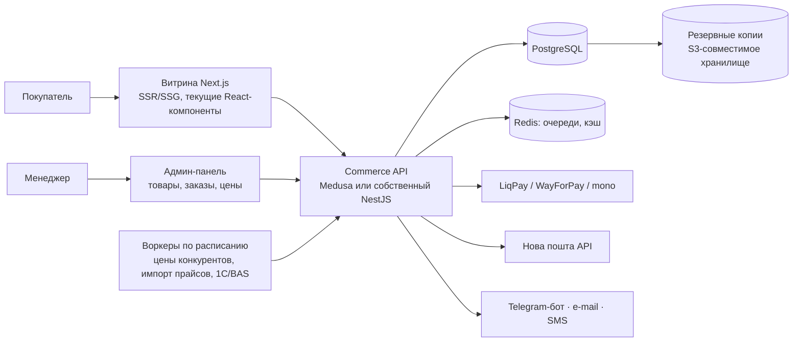

# 04. Архитектура для реального запуска

Сейчас сайт — статическое приложение (React + Vite) без сервера: каталог лежит в коде, корзина — в браузере, заказы никуда не уходят. Для работающего магазина нужна серверная часть. Ниже — рекомендуемая схема и порядок работ.

## Почему без сервера нельзя

| Функция | Почему не на фронтенде |
|---|---|
| Приём заказов | заказ должен сохраниться в базе и дойти до менеджера даже при закрытой вкладке; нужна защита от спама и подделки |
| Онлайн-оплата (LiqPay, WayForPay, plata by mono) | подпись платежа делается секретным ключом мерчанта; ключ в браузере — это доступ к деньгам |
| Цены и остатки | единый источник правды; цена в браузере легко подменяется, сервер обязан пересчитать сумму заказа сам |
| Админ-панель | вход с паролем и 2FA, права доступа, журнал действий |
| «Нова пошта», Delivery | API-ключ перевозчика, создание накладных |
| Мониторинг цен конкурентов | ключи API, расписание, обход ограничений CORS, хранение истории |
| Подбор по VIN | платные API каталогов применяемости с секретными ключами |
| SEO | страницы товаров должны приходить готовым HTML (SSR/SSG), а не собираться в браузере |

**Ключи и пароли не хранятся в коде и в GitHub** — только в переменных окружения сервера или менеджере секретов. В репозитории — лишь `.env.example` без значений.

## Рекомендуемый стек

| Слой | Выбор | Почему |
|---|---|---|
| Витрина | **Next.js** (React) | переносим текущие компоненты почти без изменений; SSR/SSG даёт индексацию товаров |
| Commerce-бэкенд | **Medusa v2** (open source, Node.js) или собственный API на NestJS | Medusa уже умеет товары, варианты, остатки, заказы, цены, админку; собственный API — если нужна нестандартная логика 1С |
| База | **PostgreSQL** | надёжно, бесплатно, полнотекстовый поиск по артикулам и названиям |
| Поиск (по мере роста > 50 тыс. позиций) | Meilisearch или Typesense | опечатки, синонимы («крыло/крило»), мгновенный поиск |
| Файлы и фото | S3-совместимое хранилище + CDN | дешёвое хранение, быстрая выдача |
| Хостинг | VPS (например, Hetzner, 2–4 vCPU) + Docker Compose; или Vercel (витрина) + управляемая БД | VPS дешевле и полностью под контролем; облако проще в обслуживании |

Альтернатива «быстрее и дешевле на старте» — готовая платформа (например, Horoshop): каталог, заказы, оплата и «Нова пошта» из коробки, а этот дизайн переносится как тема. Минус — меньше свободы для 3D-главной и собственного ценообразования. Решение зависит от бюджета и того, кто будет поддерживать сайт.

## Как будут решены задачи магазина

| Задача | Решение |
|---|---|
| Хранение товаров | PostgreSQL: товары, категории, применяемость, кросс-номера, фото |
| Добавление товаров | админка (по одному) + импорт YML/CSV/Excel (массово) + синхронизация с 1С/BAS (CommerceML/XML) |
| Редактирование цен | админка; массово — импорт прайса; автоматически — модуль ценообразования (`03-pricing.md`) |
| Остатки | из учётной системы по расписанию (каждые 15–60 мин) или ручная правка; резерв при оформлении заказа |
| Обновление каталога | ночной импорт от поставщиков + ручные правки; изменения сразу видны на сайте (ревалидация страниц) |
| Админ-панель | Medusa Admin / собственная; роли: администратор, менеджер, контент |
| Оформление заказов | форма из демо → API: проверка наличия и цены на сервере → заказ в БД → номер заказа покупателю |
| Уведомления | Telegram-бот менеджерам (мгновенно), e-mail покупателю, SMS с номером заказа и ТТН |
| Оплата | наложенный платёж + онлайн-эквайринг (LiqPay / WayForPay / plata by mono); подтверждение — по серверному callback |
| Доставка | API «Нова пошта»: поиск города и отделения в форме, создание ТТН из админки, статусы доставки |
| Безопасность | HTTPS, секреты в окружении, 2FA для админки, роли, ограничение частоты запросов, проверка всех данных на сервере, журнал действий, регулярные обновления, CSP |
| Резервные копии | ежедневный `pg_dump` + фото → внешнее хранилище, хранение 30 дней, ежемесячная проверка восстановления |
| Конкурентное ценообразование | воркер по расписанию + `engine.ts` на сервере + панель `/admin/pricing` |
| Аналитика | GA4 + Google Search Console + события электронной торговли (просмотр товара, корзина, заказ) |

## Порядок работ

1. **Данные:** выгрузка текущего каталога asiamotor.com.ua (YML/CSV), фото, применяемость; согласование структуры категорий.
2. **Бэкенд и админка:** товары, остатки, импорт, заказы, уведомления в Telegram.
3. **Витрина на Next.js:** перенос текущего дизайна, SSR, sitemap, микроразметка.
4. **Оплата и доставка:** эквайринг, «Нова пошта».
5. **Запуск на домене** asiamotor.com.ua: 301-редиректы со старых адресов, Search Console, мониторинг.
6. **Ценообразование:** источники цен, режим подтверждения → после проверки авторежим.

## Что из текущего кода переиспользуется

- Все страницы и компоненты (`src/pages`, `src/components`) — перенос в Next.js почти без изменений.
- `src/data/catalog.ts` → схема таблиц и функции фильтрации (`fit`, `query`) переезжают на сервер.
- `src/pricing/engine.ts` — без изменений на сервере, с теми же тестами.
- `scripts/prerender.mjs` заменяется на SSR Next.js.
